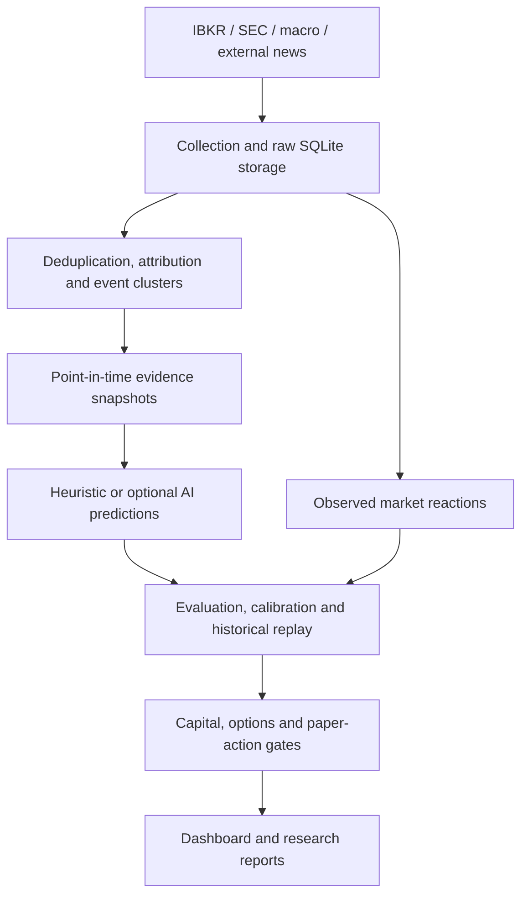

# IBKR Event-Driven Quantitative Trading Research Platform

**Python · SQLite · IBKR API · pandas · Pydantic · pytest**

[](https://github.com/dream1004sdf/IBKR_Event_Driven_Quantitative_Trading_Research_Platform/actions/workflows/tests.yml)

An event-driven quantitative trading research platform that turns news and macroeconomic events into asset-level research hypotheses, measures subsequent market reactions, and evaluates probabilistic forecasts. It combines market-data engineering, signal research, point-in-time replay, probability calibration, and capital/options risk checks in a single Python codebase.

The research objective is to test whether an event contains useful information about future asset returns. The engineering goal is to make each experiment traceable: what evidence was available at the decision time, which company or proxy asset it referred to, how the outcome was measured, and why a proposed paper action was accepted or blocked.

## Role in a quantitative trading system

This project implements the data, event-modeling, quantitative evaluation, and paper-decision components of a systematic trading workflow.

| Component | Implementation in this repository |
|---|---|
| Research data infrastructure | News, prices, filings and macroeconomic collection; SQLite storage and source lineage |
| Event and candidate-signal research | Subject attribution, event clustering, affected-asset mapping, heuristic and optional AI forecasts |
| Quantitative validation | Observed reaction returns, directional and probability metrics, calibration, historical replay and leakage checks |
| Capital and options risk controls | Budget and margin context, quote freshness, option structures, candidate ranking and paper-action gates |
| Execution preparation | Simulated tickets, broker what-if requests and readiness checks; full live order/fill/position integration remains further work |

The strategy-research approach is **event-driven**: identify a news or macro event, map its affected assets, form a forecast using information available at that time, and compare it with later market outcomes. Quantitative validation determines whether a research hypothesis can advance to paper testing.

## What it does

- **Collects evidence:** IBKR news and market data, SEC filings and financial facts, FRED and international macroeconomic sources.
- **Preserves data lineage:** raw and derived records, provider identity, availability timestamps, input hashes, versioned mappings, and resumable collection jobs.
- **Resolves event targets:** separates a news-delivery ticker from the actual subject, groups related articles, and distinguishes direct entities, context assets, and event proxies.
- **Evaluates forecasts:** directional metrics, Brier score, log loss, reliability curves, calibration, return errors, and replay comparisons.
- **Checks point-in-time integrity:** rejects future evidence, updated article content, outcome fields in model inputs, and ineligible timestamps.
- **Builds paper-trading context:** account budgets, option structures, quote freshness, risk gates, candidate ranking, and simulated ticket previews.
- **Reports operational state:** a local Trading Command Center and structured JSON/Markdown outputs.

## Architecture



The runtime uses Python commands and background loops with SQLite and file-based artifacts. See [architecture](docs/ARCHITECTURE.md) for the module map and data flow.

## Run an offline example

Python 3.11 or later is recommended. The current local validation uses Python 3.13.14.

```bash
python -m venv .venv
# Windows: .venv\Scripts\activate
# macOS/Linux: source .venv/bin/activate
python -m pip install -r requirements-dev.txt
python examples/offline_demo.py
python -m pytest -q
```

The example uses synthetic news and quotes to demonstrate deduplication, reaction measurement, and SQLite restart persistence. It does not require an IBKR session, market-data subscription, API key, or private research database.

Run `python main.py --help` to inspect the research commands. External collection and AI commands need their own service configuration; the offline example and tests are the reproducible starting point.

## Repository layout

| Path | Responsibility |
|---|---|
| [`main.py`](main.py) | Command-line entry point |
| [`recorder/`](recorder/) | Ingestion, lineage, evidence, scoring, market outcomes, risk gates, dashboard |
| [`prediction_evaluation/`](prediction_evaluation/) | Metrics, calibration, evaluation storage, replay |
| [`scripts/`](scripts/) | Historical collection, repair, clone research and audit runners |
| [`config/`](config/) | Versioned research and operating policies |
| [`tests/`](tests/) | Synthetic, temporary-database and mocked-service tests |
| [`examples/`](examples/) | Offline demonstration |
| [`docs/`](docs/) | Architecture, testing and research status |

## Validation and research status

The project has working ingestion, evaluation, replay, semantic review, and paper-readiness modules. The latest historical research stage selects a primary proxy using only sessions completed before the event. Missing candidate data causes an explicit abstention.

The public snapshot passed **854 automated tests** in a newly installed Windows/Python 3.13 environment. Exact commands, package versions, and coverage limits are recorded in [testing](docs/TESTING.md). Historical dataset counts and remaining work are documented in [research status](docs/RESEARCH_STATUS.md).

The research remains in validation. Broker adapters include explicit **what-if** margin/commission requests, while automated broker refresh is disabled in the default profile. The repository does not establish profitable or production-ready live trading.

## Development

This personal project was developed iteratively with Codex assistance: define a data or execution invariant, implement a bounded change, test it with synthetic fixtures, audit a research clone, and review the result before advancing. Failed experiments and incomplete data are recorded rather than treated as validated signals.

Lumibot was evaluated as a research challenger and later retired from the active research integration. The main application uses the IBKR API directly; Lumibot is not a dependency of this snapshot.

## Configuration and data

`.env.example` contains placeholders. Account credentials, broker snapshots, licensed news bodies, research databases, logs, and generated runtime files are excluded. Private source-control history is not included in this public snapshot.

The source `VERSION` marker is retained for compatibility; [research status](docs/RESEARCH_STATUS.md) explains the newer research work.
